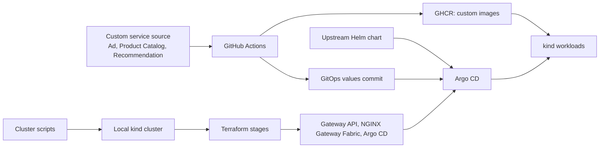

# otel-demo-infra-kind

A local platform engineering project that creates a **kind** cluster and delivers the upstream **[OpenTelemetry Demo](https://opentelemetry.io/docs/demo/)** through **Terraform, Helm, Argo CD, GitHub Actions, and GitHub Container Registry (GHCR)**.

The deployment uses custom versions of `Ad`, `Product Catalog`, and `Recommendation`,
built from [otel-demo-apps](https://github.com/lackito/otel-demo-apps) and published to GHCR. GitOps image overrides
replace the corresponding upstream images while retaining the upstream
OpenTelemetry Demo Helm chart.

This repository owns the local cluster lifecycle, platform services, and Argo CD
Application registration.

## Related repositories

- [otel-demo-apps](https://github.com/lackito/otel-demo-apps): Custom services source, build, and release workflows.
- [otel-demo-gitops-kind](https://github.com/lackito/otel-demo-gitops-kind): local kind application desired state and routing.

## How it works



- Cluster scripts create and delete the local kind cluster.
- Terraform installs Gateway API, NGINX Gateway Fabric, and Argo CD, then registers the Application in a separate stage.
- Custom services (`Ad`, `Product Catalog`, and `Recommendation`) each have an independent release workflow.
- Release workflows publish custom service images to GHCR and update their image overrides.
- Argo CD deploys the workloads.

## Start here

| Goal | Guide |
| --- | --- |
| Create, validate, access, or destroy the environment | [Operations](docs/OPERATIONS.md) |
| Understand ownership, delivery, and telemetry | [Architecture](docs/ARCHITECTURE.md) |
| Diagnose a failed check | [Troubleshooting](docs/TROUBLESHOOTING.md) |

Create the cluster first, then apply the Terraform platform stage followed by
the application stage. Routine teardown uses `application-destroy` →
`platform-destroy` → `cluster-destroy` through Make.

The cluster is `otel-demo`; kind generates context `kind-otel-demo`.
The local release workflows publish ARM64 images. Telemetry storage is ephemeral.
CI checks configuration and syntax; runtime checks verify the deployed system.

## Validate the application

From this repository's root, after creating the cluster and applying both
Terraform stages:

```bash
make application-validate
```

This reads the `kind-otel-demo` context, checks Argo CD health, Gateway conditions,
and deployment rollouts, and prints the image references for all three custom
services. It does not change resources. See [validation](docs/OPERATIONS.md#validate-the-deployment)
for image comparison, routing, and telemetry checks.

## Other repositories

- [otel-demo-infra-aws](https://github.com/lackito/otel-demo-infra-aws): AWS infrastructure and platform.
- [otel-demo-gitops-aws](https://github.com/lackito/otel-demo-gitops-aws): AWS application desired state.

See [Names and repositories](https://github.com/lackito/otel-demo-apps/blob/main/docs/NAMING.md)
for the shared naming reference.
